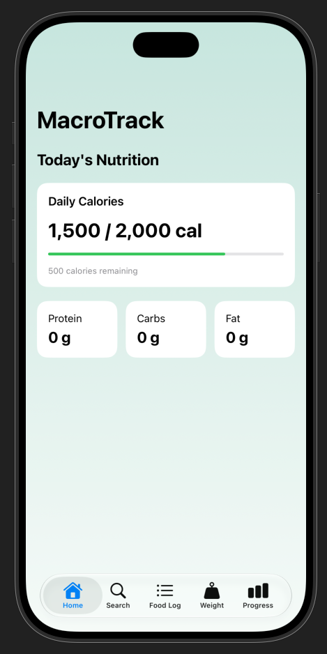
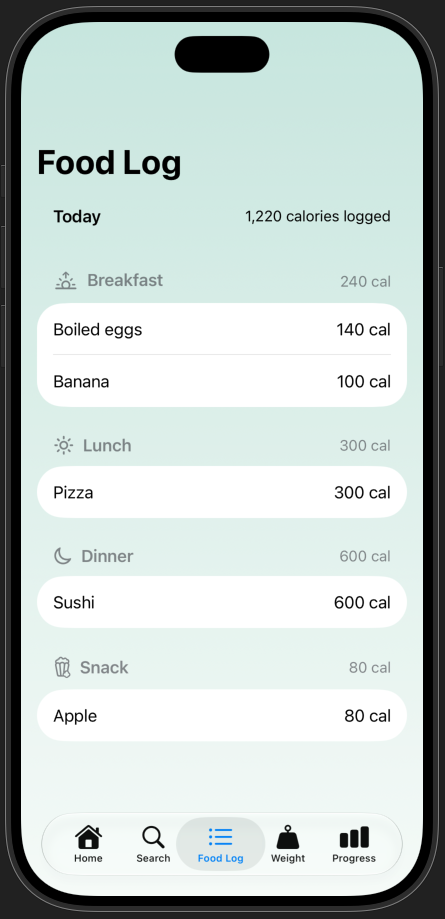

# MacroTrack

MacroTrack is a simple iOS application built using SwiftUI that helps users track their daily nutrition and weight progress.

The goal of this project is to make it easier for users to monitor their calorie intake, macronutrients, and body weight.

## Current Features

### Dashboard

- Displays daily calories and calorie goals
- Shows remaining calories and progress toward the daily goal
- Changes the progress bar color when the calorie goal is exceeded
- Displays placeholders for protein, carbohydrates, and fats

### Food Log

- Organizes foods into Breakfast, Lunch, Dinner, and Snacks
- Displays food names and calorie information
- Calculates calorie subtotals for each meal
- Calculates total daily calories from all meals
- Uses sample food data for testing

## Planned Features

- Add and remove foods from the Food Log
- Search for foods and retrieve nutrition information using an API
- Track protein, carbohydrates, and fats
- Connect Food Log data to the Dashboard
- Record and track body weight
- View nutrition and weight progress through charts
- Save food logs and weight entries locally
- Support light and dark mode

## Technologies

- **Swift** – Programming language
- **SwiftUI** – User interface
- **Xcode** – Development environment
- **Git & GitHub** – Version control

## Screenshots

## Project Status

Currently in development. The Dashboard and Food Log interfaces are implemented with sample data and basic calorie calculations. Additional tracking features are planned.

## About

This project is being developed for CPSC 411 (Mobile Device Application Programming).