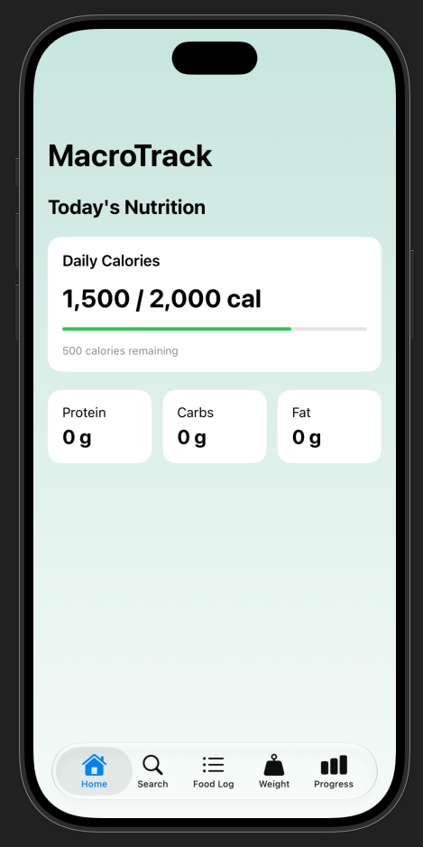
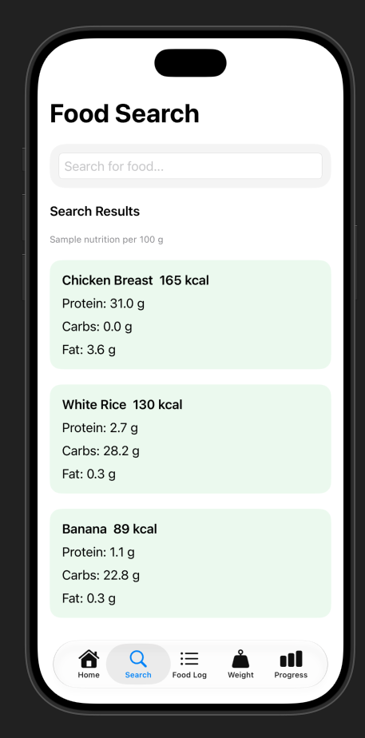
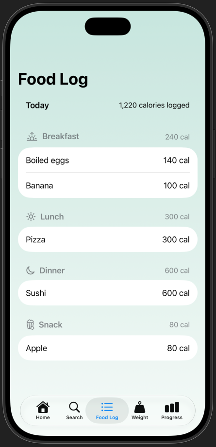
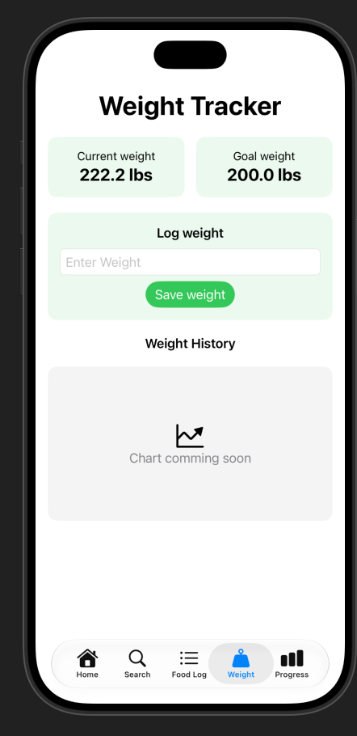
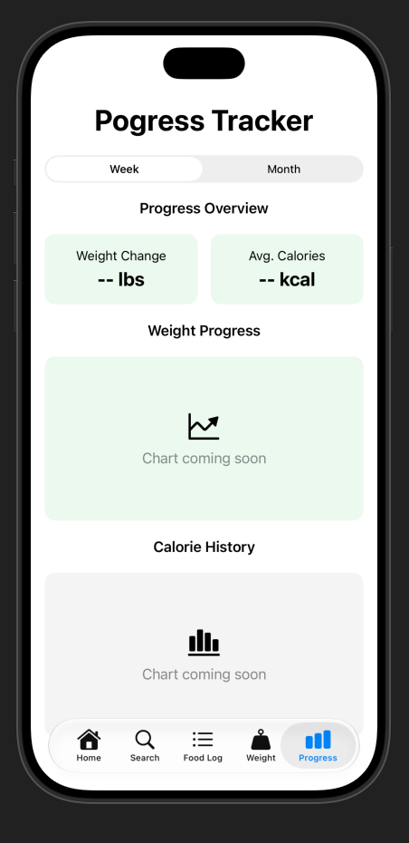

# MacroTrack

## About

MacroTrack is an iOS nutrition and weight-tracking application developed for **CPSC 411 – Mobile Device Application Programming** at **California State University, Fullerton**.

Built using **Swift and SwiftUI**, MacroTrack helps users monitor their daily calorie intake, macronutrients (protein, carbohydrates, and fats), and body weight.

The goal of this project is to provide a simple, user-friendly application that makes tracking nutrition and fitness progress easier.

## Current Features

### Dashboard
- Displays daily calories consumed and the daily calorie goal.
- Shows a progress bar and remaining calories.
- Changes the progress bar color when the calorie goal is exceeded.
- Includes cards for protein, carbohydrates, and fat (currently placeholder values).

### Food Search
- Displays sample foods with calories, protein, carbohydrates, and fat.
- Filters sample foods by name as the user types.
- Uses the shared `Food` model to represent food information.
- **API integration is not implemented yet.**

### Food Log
- Organizes sample food entries into Breakfast, Lunch, Dinner, and Snacks.
- Displays food names and calorie values.
- Calculates subtotals for each meal and a daily calorie total.
- Currently uses sample entries rather than foods added by the user.

### Weight Tracker
- Displays current and goal weight.
- Allows the user to enter a new weight and update the displayed current weight.
- Includes a placeholder for a future weight-history chart.
- Weight entries are not saved between app launches yet.

### Progress Tracker
- Includes a Week/Month selection picker.
- Displays placeholder summary values for weight change and average calories.
- Includes placeholders for future weight-progress and calorie-history charts.
- Charts and statistics are not yet connected to stored data.

## Screenshots

These screenshots show the current app interface using sample and placeholder data.

| Dashboard | Food Search | Food Log |
|:---:|:---:|:---:|
|  |  |  |

| Weight Tracker | Progress Tracker |
|:---:|:---:|
|  |  |

## Project Structure

```text
MacroTrack/
├── Models/
│   └── Food.swift
├── Views/
│   ├── DashboardView.swift
│   ├── FoodSearchView.swift
│   ├── FoodLogView.swift
│   ├── WeightView.swift
│   └── ProgressScreen.swift
├── ContentView.swift
└── MyApp.swift
```

`ContentView.swift` uses a `TabView` to switch between the five main screens. The `Food` model holds information shared by food-related views. The app currently uses SwiftUI views, local sample data, and state properties to display and update information.

## Technologies

- **Swift** — Programming language
- **SwiftUI** — User interface, navigation, and state management
- **Xcode** — Development environment and iOS Simulator
- **Git & GitHub** — Version control and project collaboration

## Next Steps

1. **Integrate a nutrition API:** Make a working `GET` request, decode its response, and display real nutrition information in Food Search.
2. **Document the API checkpoint:** Capture screenshots showing the request method, endpoint URL, and returned results.
3. **Connect Food Search and Food Log:** Let users choose a food and add it to a meal.
4. **Connect Food Log and Dashboard:** Calculate daily calories and macronutrients from the same logged entries.
5. **Add weight history and charts:** Store weight entries and visualize weight and calorie trends.
6. **Add local persistence and refine the UI:** Preserve entries between launches, improve consistency, and test light/dark appearances.

## Project Status

**In development — Sprint 2.** The five main screens have initial layouts, including sample food data, calorie calculations, weight input, and chart placeholders. The next priority is a working nutrition API request. Features such as synced totals, saved history, and real charts remain planned work.
