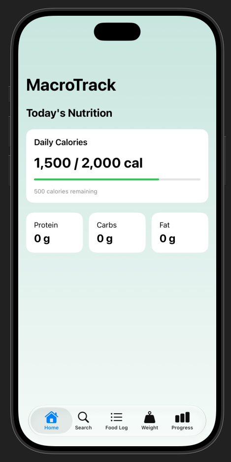
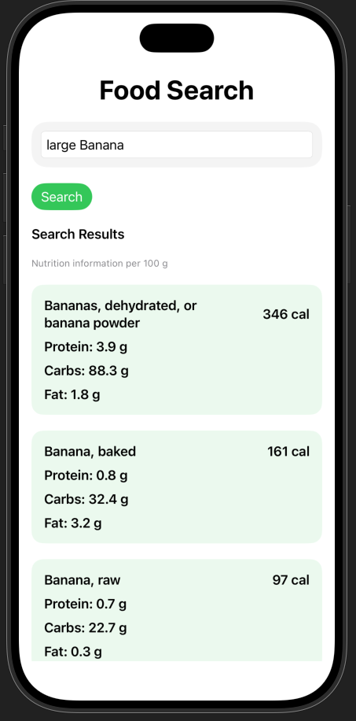
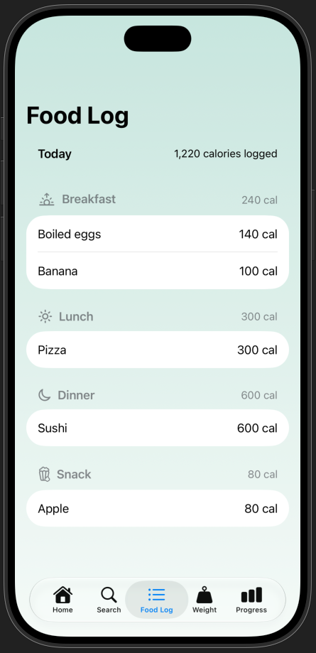
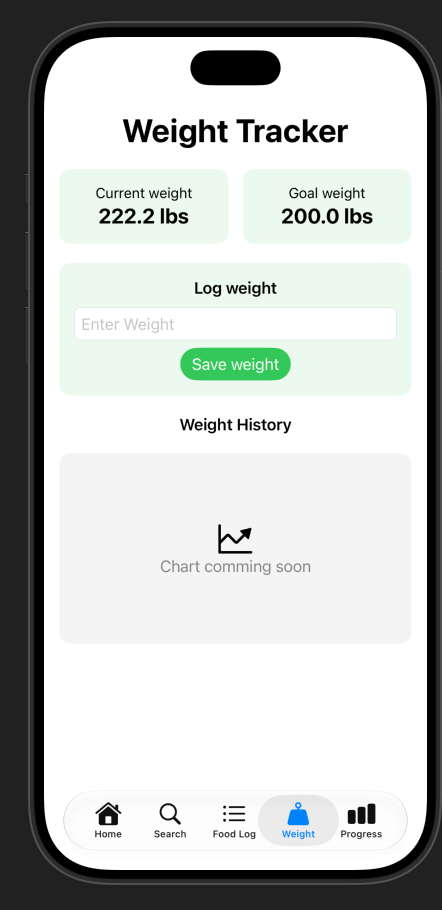
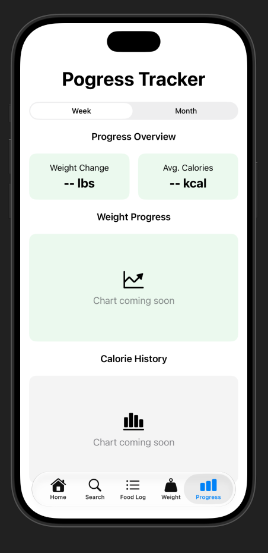

# MacroTrack

## About

MacroTrack is an iOS nutrition and weight-tracking application developed for **CPSC 411 – Mobile Device Application Programming** at **California State University, Fullerton**.

Built using **Swift and SwiftUI**, MacroTrack helps users monitor their daily calorie intake, macronutrients (protein, carbohydrates, and fats), and body weight.

The goal of this project is to provide a simple, user-friendly application that makes tracking nutrition and fitness progress easier.

## Current Features

### Dashboard
- Displays daily calories consumed and the daily calorie goal.
- Shows a progress bar and remaining calories.
- Changes the progress bar color when the calorie goal is exceeded.
- Includes cards for protein, carbohydrates, and fat.
- Currently uses sample nutrition values.

### Food Search
- Integrates the **USDA FoodData Central API** to retrieve real food information.
- Allows users to search for foods by name.
- Displays matching food results with calories, protein, carbohydrates, and fat per 100 grams.
- Uses `URLSession` and HTTP GET requests to retrieve API data.
- Uses `JSONDecoder` to convert JSON responses into Swift food models.
- Includes loading indicators, error handling, and empty-result messages.
- Uses the MVVM architecture to separate API requests, search logic, and the user interface.
- Successfully tested using searches such as Apple and Captain Crunch.

### Food Log
- Organizes sample food entries into Breakfast, Lunch, Dinner, and Snacks.
- Displays food names and calorie values.
- Calculates subtotals for each meal and a daily calorie total.
- Currently displays sample entries.

**In Progress:**
- Created `FoodEntry.swift` to represent individually logged foods.
- Created `FoodLogViewModel.swift` to manage food entries and calculate nutritional totals.
- Added functions for adding, updating, deleting, and filtering foods by meal.
- These new components are not yet connected to the Food Log interface.

### Weight Tracker
- Displays current and goal weight.
- Allows the user to enter a new weight and update the displayed current weight.
- Includes a placeholder for a future weight-history chart.
- Weight entries are not saved between app launches yet.

### Progress Tracker
- Includes a Week/Month selection Picker.
- Displays placeholder summary values for weight change and average calories.
- Includes placeholders for future weight-progress and calorie-history charts.
- Charts and statistics are not yet connected to stored data.

## USDA API Integration

MacroTrack uses the **USDA FoodData Central API** to retrieve nutritional information.

The application sends HTTP GET requests using `URLSession` and processes the returned JSON using `JSONDecoder`.

**API Endpoint:**

`https://api.nal.usda.gov/fdc/v1/foods/search`

**Request Method:** GET

The API returns matching foods with nutritional information, including calories, protein, carbohydrates, and fat.

The API key is configured locally using an Xcode configuration file and is not intended to be included in the public GitHub repository.

## Screenshots

### Main Application Screens

The following screenshots show the five main MacroTrack screens. Some screens still contain sample data and placeholders.

| Dashboard | Food Search | Food Log |
|:---:|:---:|:---:|
|  |  |  |

| Weight Tracker | Progress Tracker |
|:---:|:---:|
|  |  |

### USDA Food Search Integration

The following screenshots demonstrate successful food searches using real USDA FoodData Central API results.

| Apple Search | Captain Crunch Search |
|:---:|:---:|
|  |  |

These tests demonstrate that MacroTrack can retrieve and display different food results dynamically, including calorie and macronutrient information.

## Project Structure

```text
MacroTrack/
├── Models/
│   ├── Food.swift
│   ├── USDAFood.swift
│   └── FoodEntry.swift
│
├── Services/
│   └── FoodAPIService.swift
│
├── ViewModels/
│   ├── FoodSearchViewModel.swift
│   └── FoodLogViewModel.swift
│
├── Views/
│   ├── DashboardView.swift
│   ├── FoodSearchView.swift
│   ├── FoodLogView.swift
│   ├── WeightView.swift
│   └── ProgressScreen.swift
│
├── ContentView.swift
└── MyApp.swift
```

The application uses the **Model-View-ViewModel (MVVM)** architecture for food searching and the developing food logging functionality.

- **Models:** Define food information, USDA responses, and logged food entries.
- **Services:** Handle communication with the USDA FoodData Central API.
- **ViewModels:** Manage application data, search results, loading states, and food logging logic.
- **Views:** Display information and allow users to interact with the application.

`ContentView.swift` uses a `TabView` to navigate between the five main screens.

## Technologies

- **Swift** — Programming language.
- **SwiftUI** — User interface, navigation, and state management.
- **Foundation** — Networking, JSON decoding, and data handling.
- **Combine** — Observable application state using `ObservableObject` and `@Published`.
- **USDA FoodData Central API** — Real food and nutritional information.
- **Xcode** — Development environment and iOS Simulator.
- **Git & GitHub** — Version control and project documentation.

## Development Progress

### Sprint 1 — Initial Application Setup (Completed)
- Created the five main SwiftUI screens.
- Implemented TabView navigation.
- Built initial layouts using sample data.
- Added basic weight input and progress placeholders.

### Sprint 2 — USDA API Integration (Completed)
- Tested the Open Food Facts API.
- Researched and selected USDA FoodData Central.
- Configured the USDA API connection.
- Created USDA food models.
- Implemented the API service and Food Search ViewModel.
- Connected Food Search to real API results.
- Successfully tested dynamic searches in the iOS Simulator.

### Sprint 3 — Food Logging and Meal Management (In Progress)
- Created the Food Entry model.
- Created the Food Log ViewModel.
- Implemented functions for managing food entries and calculating nutritional totals.
- Planned food selection and editing using a Food Detail Sheet.
- Working toward connecting Food Search, Food Log, and Dashboard.

## Next Steps

1. **Implement Food Detail Sheet:** Allow users to select foods, enter quantities in grams, and choose a meal category.
2. **Connect Food Search and Food Log:** Add selected foods to the user's meal entries.
3. **Implement Food Log Management:** Allow users to edit quantities, move foods between meals, and delete entries.
4. **Connect Food Log and Dashboard:** Automatically update daily calories and macronutrients.
5. **Add Local Persistence:** Preserve logged food and weight information between app launches.
6. **Complete Weight Tracking and Charts:** Implement functional weight history and nutrition progress graphs.
7. **Final Testing and UI Improvements:** Test application functionality, fix bugs, and improve interface consistency.

## Project Status

**In Development — Sprint 3: Food Logging and Meal Management**

The USDA FoodData Central API integration and dynamic Food Search functionality are complete and working in the iOS Simulator.

The Food Entry model and Food Log ViewModel have been created to support the next stage of development.

My current priority is implementing food selection, meal logging, and dynamic calorie and macronutrient calculations across Food Log and Dashboard.

Persistence, functional progress charts, and final UI improvements remain planned work.